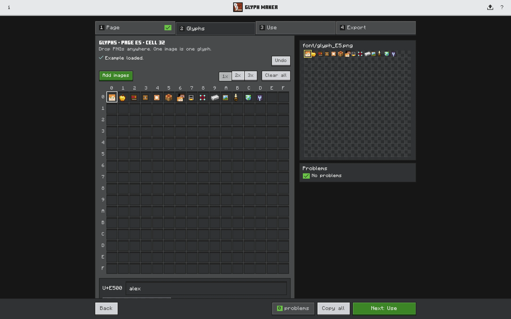
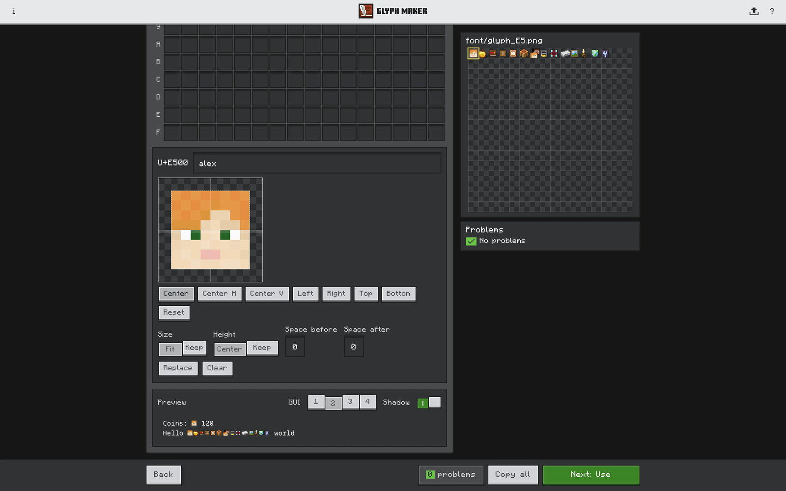
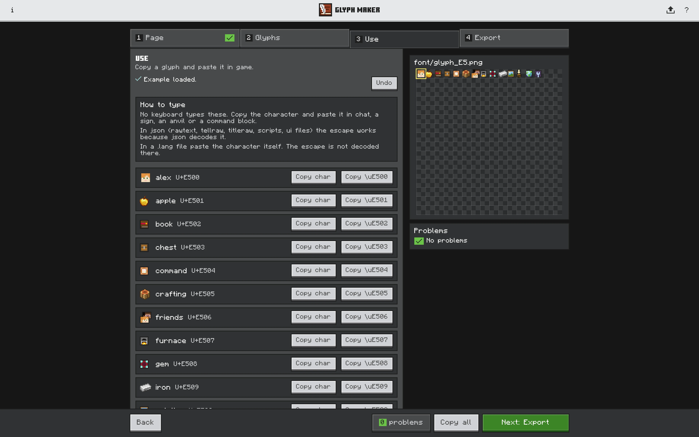
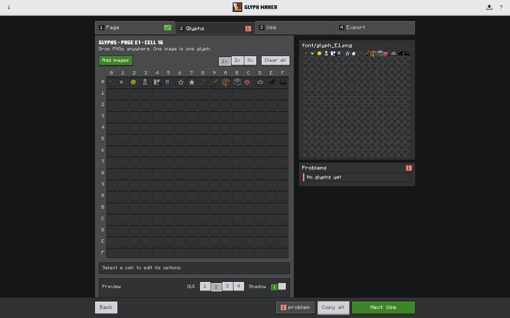

# Glyph Maker

A web tool for Bedrock custom glyph sheets. Drop your images, see them in a live sheet and in-game text, and export the sheet or a ready pack.

**Open it:** https://duskaraa.github.io/glyph-maker/

## Features

- **Page:** E0 to F8, cells of 16, 32 or 64
- **Glyphs:** Drop PNGs, one image is one glyph
- **Placement:** Drag, center and align in the cell
- **Preview:** Live sheet and in-game text with GUI scale and shadow
- **Export:** PNG, .mcpack or pack + source

## Screenshots

Placement: drag the glyph or center and align it in its cell.

Use: copy the character or the escape for chat, tellraw and lang.

Page E1: Mojang's own glyphs show in their cells and stay in the export.

## About

Glyph Maker is a single HTML file with no install and no account. It runs fully in the browser; your files never leave your computer.

Made by [Duskaraa](https://duskaraa.github.io/).

Not an official Minecraft product. Not approved by or associated with Mojang or Microsoft.

## License

[MIT](LICENSE). Minecraft textures, fonts and screenshots belong to Mojang and are not covered by this license.
